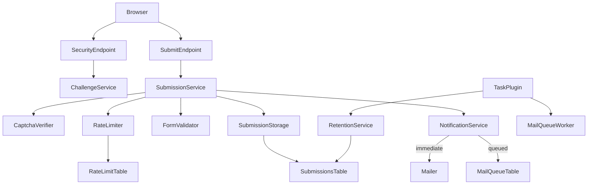

# DevArt Forms — Architecture

## Repository Layout

`source/` is the only development source:

- `source/package/` — outer Joomla package manifest and package language.
- `source/extensions/component/com_devartforms/` — administrator and site
  component source with shared media assets.
- `source/extensions/plugins/plg_task_devartforms/` — scheduled task plugin
  (retention purge, mail queue, Cloudflare IP refresh).
- `source/extensions/plugins/plg_extension_devartforms/` — Options params merge plugin.
- `source/extensions/plugins/plg_content_devartforms/` — `{devartform id="N"}`
  shortcode content plugin.
- `source/extensions/modules/mod_devartforms/` — site module embed.
- Per-form Mailchimp subscribe URL under `settings_json.integrations`
  (browser-side forward after successful submit).

Generated packages belong only under `builds/`.

## Package Composition

The package manifest declares:

- `com_devartforms`
- `plg_task_devartforms` (group `task`)
- `plg_extension_devartforms` (group `extension`)
- `plg_content_devartforms` (group `content`)
- `mod_devartforms` (site)

The build tooling derives the package name, version, inner archive names, and
inner archive folder from the package manifest. Package `script.php` enables the
task and extension plugins after install/update, enables the content shortcode
plugin on fresh install only (intentional disable survives updates), and applies
additive schema changes.

## Administrator

The component provides Joomla administrator views for:

- Dashboard
- Forms
- Form creation and editing
- Submissions (light list, JSON detail, streaming CSV export)

Form configuration includes fields, multilingual messages, submission storage,
email notifications, retention, and optional security mechanisms.

Granular ACL actions:

- `devartforms.submissions.view`
- `devartforms.submissions.export` (defaults to Super User / `core.admin`)
- `devartforms.submissions.delete`

## Frontend and Submission Flow

Forms render through component menu items, `mod_devartforms`, and the
`{devartform id="N"}` shortcode. The submission pipeline is
Controller → Service → Storage:

1. CSRF token check (`DisplayController`)
2. `SubmissionService` orchestration:
   - honeypot
   - anti-spam (PoW HMAC bound to `submission_key`, reCAPTCHA, or Turnstile)
   - CF-aware IP + independent rate limit (`ClientIpResolver`, `RateLimiter`)
   - field validation (`FormValidator`)
   - one-time `submission_key` claim (`ChallengeService` / `#__devartforms_keys`)
   - storage (`SubmissionStorage`)
   - notifications (`NotificationService` immediate or queued)

PoW challenges sign `form|ts|rand|difficulty|key`. A solved challenge is valid
for exactly one key. Duplicate claims return the form success message so a
lost-response retry looks identical to first success.

## Security Mechanisms

PoW, reCAPTCHA v2, and Turnstile are optional and independent. Enabling or
disabling one mechanism does not require either of the others.

Cloudflare-aware client IP resolution trusts `CF-Connecting-IP` only when
`trusted_proxy_mode=cloudflare` and `REMOTE_ADDR` is in Cloudflare ranges or
admin-supplied CIDRs.

Submission data and retention settings must be handled as sensitive operational
data. Stored IP/UA metadata is hash-only.

## Retention and Mail Queue

Retention cleanup is not performed lazily on submit. Install/update of
`plg_task_devartforms` seeds Joomla Scheduled Tasks once (component param
markers) for `devartforms.purge` (daily), `devartforms.mailqueue` (every
5 minutes), and `devartforms.cloudflare_ips` (weekly, enabled only when
Trusted Proxy Mode is Cloudflare). Deleted tasks are not recreated. The
dashboard reports plugin and task health. Drive the Scheduler with Lazy
Scheduler or `php cli/joomla.php scheduler:run`; mail-queue latency depends
on how often the scheduler is triggered.

The purge deletes expired submissions (and related mail queue rows), orphans
(select-ids then delete-by-ids), aged mail-queue payloads, expired keys, and
old rate-limit windows (batched with max-batch budgets).

Optional queued mail uses `mail_delivery=queued` (default remains `immediate`)
and the `devartforms.mailqueue` routine. Immediate delivery under PHP-FPM writes
an outbox row (`processing`) before `fastcgi_finish_request`, then deletes or
requeues after SMTP. Stuck `processing` rows older than 15 minutes are requeued
(at-least-once delivery) on the next mailqueue tick.

## Admin Search Scale

The submissions list searches `name_preview` / `email_preview` with predictable
`LIKE '%term%'` (and exact email match when the term contains `@`). `data_json`
deep search runs only when a form filter is selected.

## Cloudflare IP Ranges

Built-in Cloudflare CIDRs are the fail-closed baseline. The scheduled purge
task (and the dedicated `devartforms.cloudflare_ips` routine) may refresh
`administrator/cache/com_devartforms/cloudflare_ips.json` from Cloudflare's
published lists. On fetch failure the built-in lists remain active.

## Access Control Scope

Component ACL covers administrator create/manage and submissions
(`core.*` plus `devartforms.submissions.view|export|delete`).

Each form has a standard Joomla **Access** view level (`access` column). The
site renderer and submit pipeline honour it via `FormRepository::isAccessible()`.
There is no per-form administrator ACL asset matrix.

## Cache Strategy

Frontend rendering and submission endpoints must be tested with Joomla cache
enabled and disabled and behind Cloudflare. Cached pages must not prevent valid
submissions or cause duplicate processing. Security bootstrap and submit
endpoints (`task=security` and `task=submit`) send no-store cache headers; page
HTML may still be cached, but those JSON endpoints must bypass Full Page Cache
and Cloudflare HTML cache (Cache Everything rules must exclude them).

`trusted_proxy_mode` (component Options) is independent of caching: leave it at
`none` unless the site sits behind Cloudflare and you intentionally trust
`CF-Connecting-IP` for rate limiting. Enabling Cloudflare proxy mode does not
replace cache bypass rules for the security/submit endpoints.

## Build and Validation

- `scripts/validate.php` validates manifests, references, versions, XML, JSON,
  PHP syntax, and the PHP minimum.
- `scripts/build.php` creates the declared inner extension ZIPs, the outer
  package, and its SHA-256 checksum.
- Build tooling does not modify `source/` and does not overwrite an existing
  build.
